# HorsePrediction ER Diagram

`database/models.py` の現行SQLAlchemyモデルを基準にしたER図です。

```mermaid
erDiagram
    RACES {
        string race_id PK
        string race_date
        string racecourse
        int race_number
        json payload
        datetime created_at
    }

    HORSES {
        string horse_id PK
        string horse_name
        json payload
    }

    RACE_ENTRIES {
        int id PK
        string race_id FK
        string horse_id FK
        int horse_number
        int frame_number "nullable"
        bool scratched
        json payload
    }

    PAST_PERFORMANCES {
        int id PK
        string horse_id FK
        string observed_in_race_id FK "nullable"
        string race_date
        string racecourse "nullable"
        string race_name "nullable"
        int finish_position "nullable"
        json payload
        datetime stored_at
    }

    PREDICTIONS {
        int id PK
        string race_id FK
        string horse_id FK
        string model_version
        string feature_version
        float win_probability
        json payload
        datetime prediction_timestamp
    }

    PREDICTION_SNAPSHOTS {
        int id PK
        string race_id FK
        string horse_id FK
        int horse_number
        datetime prediction_timestamp
        string model_version
        string feature_version
        int simulation_seed
        float ai_win_probability
        float ai_top2_probability
        float ai_top3_probability
        json raw_features
        json prediction_payload
    }

    PREDICTION_METRICS {
        int prediction_snapshot_id PK,FK
        float base_score "nullable"
        float condition_adjustment "nullable"
        float uncertainty "nullable"
        float confidence "nullable"
        int base_rank "nullable"
        int final_rank "nullable"
        int rank_delta "nullable"
        float current_form "nullable"
        float condition_fit "nullable"
        float previous_race_residual "nullable"
        float rebound_score "nullable"
        int field_size "nullable"
        json jev_features "nullable"
    }

    CHALLENGER_PREDICTIONS {
        int id PK
        int prediction_snapshot_id FK
        string model_version
        string feature_version "nullable"
        string target
        float predicted_value
        json metadata_json
        datetime created_at
    }

    ANALYSIS_RUNS {
        int id PK
        string race_id FK
        string provider_name
        string parse_status
        int recognized_entries
        int expected_entries "nullable"
        int issue_count
        json payload
        datetime created_at
    }

    SIMULATIONS {
        int id PK
        string race_id FK
        int iterations
        int seed
        json payload
        datetime created_at
    }

    USER_PREDICTIONS {
        int id PK
        string race_id FK
        int horse_number
        json payload
        datetime prediction_timestamp
    }

    RACE_RESULTS {
        string race_id PK,FK
        json payload
        string result_timestamp
        datetime stored_at
    }

    RACE_RESULT_ENTRIES {
        int id PK
        string race_id FK
        string horse_id FK "nullable"
        int horse_number
        int finish_position "nullable"
        string result_status "nullable"
        string finish_time "nullable"
        string margin "nullable"
        float final_three_furlongs "nullable"
        string corner_positions "nullable"
        int horse_weight "nullable"
        int horse_weight_change "nullable"
        string jockey_name "nullable"
        int popularity "nullable"
        int field_size "nullable"
        float relative_finish "nullable"
        string relative_finish_category "nullable"
    }

    PREDICTION_REVIEWS {
        int id PK
        string race_id FK
        json payload
        datetime created_at
    }

    DATA_FETCH_LOGS {
        int id PK
        string provider
        text url "nullable"
        int http_status "nullable"
        string content_hash "nullable"
        datetime fetched_at
        json payload "nullable"
    }

    MODEL_EVALUATIONS {
        int id PK
        string model_version
        string feature_version "nullable"
        string evaluation_period
        int training_run_id FK "nullable"
        string training_start "nullable"
        string training_end "nullable"
        string evaluation_start "nullable"
        string evaluation_end "nullable"
        float brier_score "nullable"
        float log_loss "nullable"
        float calibration_error "nullable"
        float top3_hit_rate "nullable"
        float top3_recall "nullable"
        float winner_rank_mean "nullable"
        float prediction_top3_mean_finish "nullable"
        float relative_finish_error "nullable"
        int sample_count
        int race_count
        int horse_count
        string evaluation_variant "nullable"
        json metrics_json
        datetime evaluated_at
    }

    TRAINING_RUNS {
        int id PK
        string model_version
        datetime trained_at
        string training_start "nullable"
        string training_end "nullable"
        string feature_version "nullable"
        string label "nullable"
        string status
        int row_count
        int race_count
        json metrics_json
    }

    QUALITATIVE_EVIDENCE {
        int id PK
        string source_type
        string source_name
        text source_url "nullable"
        datetime published_at "nullable"
        string author "nullable"
        string race_id FK
        string horse_id FK
        text raw_text
        text normalized_text
        float confidence "nullable"
        string content_hash
        datetime collected_at
    }

    SOURCE_RELIABILITY {
        int id PK
        string source_type
        string source_name
        float reliability "nullable"
        int sample_count
        json metrics_json
        datetime updated_at
    }

    RACES ||--o{ RACE_ENTRIES : has
    HORSES ||--o{ RACE_ENTRIES : enters
    HORSES ||--o{ PAST_PERFORMANCES : has
    RACES o|--o{ PAST_PERFORMANCES : observed_during
    RACES ||--o{ PREDICTIONS : produces
    HORSES ||--o{ PREDICTIONS : receives
    RACES ||--o{ PREDICTION_SNAPSHOTS : preserves
    HORSES ||--o{ PREDICTION_SNAPSHOTS : receives
    PREDICTION_SNAPSHOTS ||--o| PREDICTION_METRICS : has
    PREDICTION_SNAPSHOTS ||--o{ CHALLENGER_PREDICTIONS : compared_by
    RACES ||--o{ ANALYSIS_RUNS : analyzed_by
    RACES ||--o{ SIMULATIONS : simulated_by
    RACES ||--o{ USER_PREDICTIONS : marked_in
    RACES ||--o| RACE_RESULTS : has
    RACE_RESULTS ||--o{ RACE_RESULT_ENTRIES : contains
    HORSES o|--o{ RACE_RESULT_ENTRIES : identifies
    RACES ||--o{ PREDICTION_REVIEWS : reviewed_by
    TRAINING_RUNS o|--o{ MODEL_EVALUATIONS : evaluated_by
    RACES ||--o{ QUALITATIVE_EVIDENCE : has
    HORSES ||--o{ QUALITATIVE_EVIDENCE : describes
```

## Constraints

- `race_entries`: `(race_id, horse_number)` is unique.
- `past_performances`: `(horse_id, race_date, racecourse, race_name)` is unique.
- `user_predictions`: `(race_id, horse_number, prediction_timestamp)` is unique.
- `race_result_entries`: `(race_id, horse_number)` is unique.
- `race_results.race_id` is both the primary key and a foreign key, so one race has at most one stored result row.
- `prediction_metrics.prediction_snapshot_id` is both the primary key and a foreign key, so one snapshot has at most one metric row.
- `challenger_predictions`: `(prediction_snapshot_id, model_version, target)` is unique.
- `qualitative_evidence`: `(content_hash, race_id, horse_id)` is unique.
- `source_reliability`: `(source_type, source_name)` is unique.

## Logical Associations

The following relationships are represented inside JSON or by matching values and are not database foreign keys:

- `user_predictions.(race_id, horse_number)` corresponds to `race_entries.(race_id, horse_number)`.
- `race_results.payload` and `prediction_snapshots.prediction_payload` remain the canonical compatibility records; the two detail tables are searchable projections.
- Review rows and factor attribution are stored in `prediction_reviews.payload`.
- JEV consumes only saved `qualitative_evidence`; structured nullable features are frozen in `prediction_snapshots.raw_features`, `prediction_payload`, and `prediction_metrics.jev_features`.
- `challenger_predictions` stores shadow output only. The current Champion remains `baseline-v1` until an explicit promotion decision.
- `training_runs` stores each explicit baseline-training attempt, including insufficient-data runs.
- A successful walk-forward evaluation is also stored in `model_evaluations`; the link to its training run is currently by model/feature version and period, not a foreign key.
- `data_fetch_logs` is standalone because a fetch can occur before a race record is identified or created.
